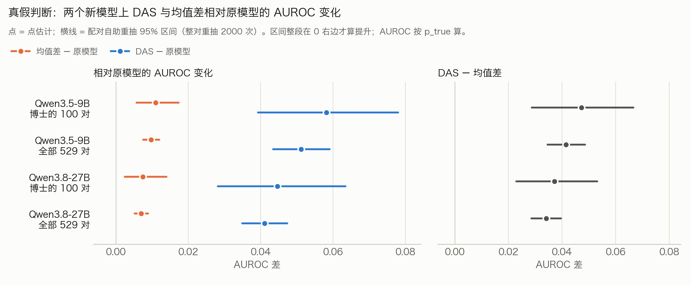
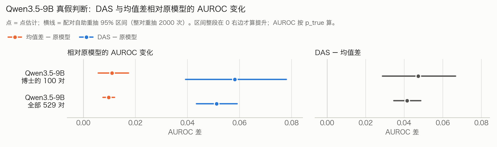

# 11 新模型的真假判断 2×2（Qwen3.5-9B、Qwen3.8-27B）

方案：[`41`](../../41_新模型Qwen3.5-9B与Qwen3.8-27B的真假判断2x2与原模型_均值差_DAS对照_方案运行前写死.md)（运行前写死）。原始输出在服务器 `results_newmodels_20261112/`；这里放表、图和关键文件。

## 状态（北京时间 2026-11-12 20:09）：全部跑完（19:47），没有失败

## 两个模型合起来：原模型、均值差、DAS（测试集；选择只在调参集上）

| 模型 | 报告集 | DAS − 原模型 AUROC | 均值差 − 原模型 | DAS − 均值差 AUROC | DAS − 原模型 J | 自报 Yes 比例变化 | 判 True 比例变化 |
|---|---|---|---|---|---|---|---|
| Qwen3.5-9B | 博士的 100 对 | **+0.058 [+0.039, +0.078]** | +0.011 | **+0.047 [+0.029, +0.067]** | +0.120 [+0.050, +0.190] | −0.015 | 0.000 |
| Qwen3.5-9B | 全部 529 对 | **+0.051 [+0.043, +0.059]** | +0.010 | **+0.041 [+0.035, +0.049]** | +0.087 [+0.055, +0.121] | −0.005 | +0.004 |
| Qwen3.8-27B | 博士的 100 对 | **+0.045 [+0.028, +0.063]** | +0.007 | **+0.037 [+0.023, +0.053]** | 0.000 [−0.080, +0.080] | +0.030 | **+0.080 [+0.040, +0.125]** |
| Qwen3.8-27B | 全部 529 对 | **+0.041 [+0.035, +0.047]** | +0.007 | **+0.034 [+0.029, +0.040]** | +0.064 [+0.026, +0.098] | +0.013 | **+0.078 [+0.060, +0.095]** |

- **事先写死的读法：两个模型、两个报告集，"提升成立"。**DAS − 原模型、DAS − 均值差的 AUROC 区间都整段在 0 以上。**积极**
- 选中的配置：
  - 9B：DAS 第 31 层力度 3，均值差第 17 层力度 3；
  - 27B：DAS 第 63 层力度 3，均值差第 50 层力度 2。
  - 两个模型的 DAS 都在最后一层。逐层看，DAS 在大多数中间层上也高于均值差。
- **27B 的毛病（消极）**：E 让模型更偏向答 True（判 True 比例 +7.8 个百分点）。所以 100 对上 AUROC 升了，J 没升。逐层看，这是 27B 后面几层的共同现象：均值差在第 58 层也偏 +5 个百分点。E 的选择规则只约束作答率、不约束偏向，按事先的读法仍算成立，但要写明。
- 按排错的比例（1 − AUROC，529 对）：
  - 9B：16.6%（均值差）→ 12.4%（DAS），少 25%；
  - 27B：15.3% → 11.9%，少 22%。

## 2×2（529 对；`tables/E23_<模型>_report_2x2_das_tfce.md`）

| 模型 | 格 | 选中 | 作答率变化 | J 变化 | AUROC 变化 | 判 True 比例变化 |
|---|---|---|---|---|---|---|
| 9B | E | E_L31_a3 | −0.005 | **+0.087** | **+0.051** | +0.004 |
| 9B | C 提示对比，往弃答 / 往作答 | Cp_L16_abst_a1 / Cp_L17_ans_a2 | **−0.046 / +0.087** | +0.015 / +0.011 | −0.001 / 0.000 | −0.013 / +0.013 |
| 9B | C 自报对比，往弃答 / 往作答 | Cs_L28_abst_a2 / Cs_L31_ans_a1 | **−0.698 / +0.284** | +0.006 / +0.011 | +0.004 / 0.000 | +0.007 / +0.015 |
| 27B | E | E_L63_a3 | +0.013 | **+0.064** | **+0.041** | +0.078 |
| 27B | C 提示对比，往弃答 / 往作答 | Cp_L62_abst_a2 / Cp_L63_ans_a1 | **−0.633 / +0.220** | +0.008 / +0.006 | 0.000 / 0.000 | −0.011 / +0.024 |
| 27B | C 自报对比，往弃答 / 往作答 | Cs_L57_abst_a2 / Cs_L60_ans_a2 | **−0.677 / +0.314** | +0.015 / −0.006 | +0.001 / −0.001 | +0.043 / −0.027 |

- **读法**（和老模型一样）：
  - E 行动判别（J、AUROC），作答率变化在 ±0.03 以内；
  - C 行动作答率，J 变化在 ±0.02 以内，判 True 比例变化在 ±0.05 以内。
- **两个模型都成立。积极**
- 9B 的 C 往弃答一格（提示对比），J 的区间上界到了 +0.030，点估计 +0.015 在线内。

## Qwen3.5-9B：原模型、均值差、DAS（测试集；选择只在调参集上）

| 报告集 | DAS − 原模型 AUROC | 均值差 − 原模型 AUROC | DAS − 均值差 AUROC | DAS − 原模型 J | 自报 Yes 比例变化（DAS） | 判 True 比例变化（DAS） |
|---|---|---|---|---|---|---|
| 博士的 100 对 | **+0.058 [+0.039, +0.078]** | +0.011 [+0.006, +0.017] | **+0.047 [+0.029, +0.067]** | +0.120 [+0.050, +0.190] | −0.015 [−0.040, 0.000] | 0.000 [−0.040, +0.040] |
| 全部 529 对 | **+0.051 [+0.043, +0.059]** | +0.010 [+0.008, +0.012] | **+0.041 [+0.035, +0.049]** | +0.087 [+0.055, +0.121] | −0.005 [−0.010, −0.001] | +0.004 [−0.014, +0.021] |

- 选中的配置：DAS 第 31 层（最后一层）力度 3；均值差第 17 层力度 3。规则：调参集上，自报 Yes 比例变化 ≤ 0.03 的条件里取 J 提升最大的。
- 绝对值（529 对）：AUROC 原模型 0.825、均值差 0.834、DAS 0.876；J 0.488、0.501、0.575；自报 Yes 比例 0.698、0.694、0.694。
- **事先写死的读法：两个报告集上"提升成立"。**DAS − 原模型、DAS − 均值差的 AUROC 区间都在 0 以上。**积极**
- 不是只靠最后一层：逐层看，第 7–15 层和第 18–30 层，DAS 的 AUROC 提升都在均值差之上。例如第 11–13 层 DAS 是 +0.027 到 +0.036，均值差约为 0。第 16、17 层两者都接近 0。（`tables/E23_qwen3.5-9b_compare_das_tfce_vs_meandiff_full.md`）
- 和老模型一样，DAS 选在最后一层（Qwen3-8B 是 36 层里的第 35 层）。最后一层的方向离输出最近，"它比输出读数更懂真假"这一点，在真假判断上本来就没法单独证明（老模型上讨论过）。

## 文件

- `tables/dr_tf_table_both.{md,json}`、`tables/dr_tf_table_qwen3.8-27b.{md,json}`；`tables/E23_<模型>_report_2x2_das_tfce.md`；`tables/E23_qwen3.8-27b_compare_das_tfce_vs_meandiff_full.md`；`tables/E1_qwen3.8-27b_summary.json`；`figures/dr_tf_both_{light,dark}.png`。

- `tables/dr_tf_table_qwen3.5-9b.{md,json}`：对照表；json 里有模型路径、库版本、选中的配置、逐题输出文件的路径和 sha256。
- `tables/E23_qwen3.5-9b_compare_das_tfce_vs_meandiff_full.md`：DAS 对均值差，含逐层表。
- `tables/E23_qwen3.5-9b_knob_sweep_{das_tfce_full,meandiff_full}.md`：两个扫描的全部条件。
- `tables/E1_qwen3.5-9b_summary.json`：方向训练的逐层记录。
- `figures/dr_tf_qwen3.5-9b_{light,dark}.png`：对照图，浅色、深色两版。
