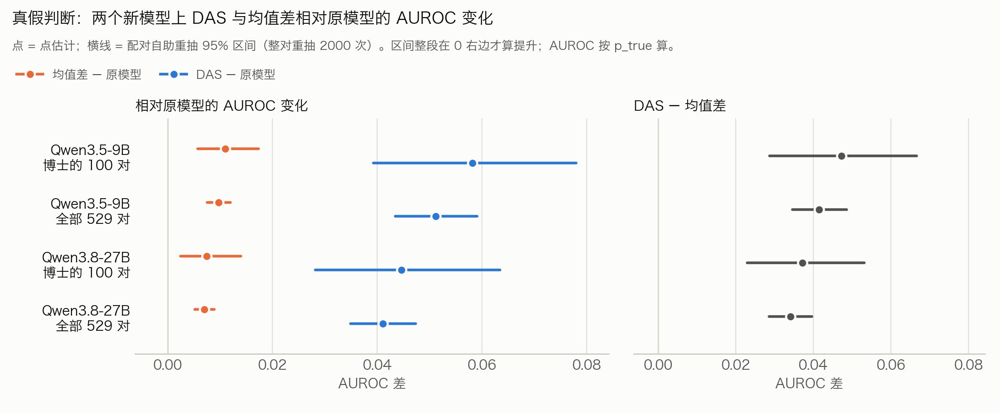

# P1. 新模型 Qwen3.5-9B、Qwen3.8-27B 上的真假判断：原模型、均值差、DAS 对照，以及 2×2

撰写：Claude（赵磊审）。北京时间 2026-11-12 20:16。对应博士 11-10 的《下一步实验安排》（同目录 [`博士建议_下一步实验安排_20261110.md`](../博士建议_下一步实验安排_20261110.md)）的第一、二部分。

## 一句话结论

**两个新模型、两个报告集（博士定的 100 对和全部 529 对）上，按主指标 AUROC，DAS 都显著胜过原模型和均值差，区间都整段在 0 以上；两个模型的 2×2 也都按事先的点估计判据成立（近似选择性，见第 3 节）。**这正是博士说的"两个新模型相比原模型和均值差都有提升，差值区间也支持这个差异"。**积极**

要如实写的一处：27B 上 E 会让模型更偏向答 True（判 True 的比例多 7.8 个百分点）。所以 27B 在 100 对上 AUROC 升了，J 没升。**消极**

## 1. 完整对照表

**名词**
- **原模型**：不做任何写入。
- **均值差**：真陈述的激活均值减去假陈述的激活均值，得到一个方向。
- **DAS**（distributed alignment search · 分布式对齐搜索 · 用梯度训练出一个"换掉它、答案就跟着换"的方向）：我们的方法。
- **AUROC**（ROC 曲线下面积）：随机拿一条真陈述、一条假陈述，模型把真的排在前面的概率。0.5 等于瞎猜，1 是全对。
- **J**（约登指数）：真陈述判真的比例减去假陈述判真的比例。
- **自报 Yes 比例**：另一遍单独问"你知道这题的答案吗？"时答 Yes 的比例。这不是实际作答率，判真假的那一遍每题都必须回答。
- **判 True 比例**：0.5 表示不偏向任何一边（真假各一半）。

**差值**（方括号是配对自助重抽的 95% 区间：整对题重抽 2000 次，同一模型的三方用同一批重抽）

| 模型 | 报告集 | DAS − 原模型 AUROC | 均值差 − 原模型 AUROC | DAS − 均值差 AUROC | DAS − 原模型 J | DAS − 均值差 J |
|---|---|---|---|---|---|---|
| Qwen3.5-9B | 博士的 100 对 | **+0.058 [+0.039, +0.078]** | +0.011 [+0.006, +0.017] | **+0.047 [+0.029, +0.067]** | +0.120 [+0.050, +0.190] | +0.090 [+0.030, +0.160] |
| Qwen3.5-9B | 全部 529 对 | **+0.051 [+0.043, +0.059]** | +0.010 [+0.008, +0.012] | **+0.041 [+0.035, +0.049]** | +0.087 [+0.055, +0.121] | +0.074 [+0.045, +0.104] |
| Qwen3.8-27B | 博士的 100 对 | **+0.045 [+0.028, +0.063]** | +0.007 [+0.002, +0.014] | **+0.037 [+0.023, +0.053]** | 0.000 [−0.080, +0.080] | 0.000 [−0.070, +0.080] |
| Qwen3.8-27B | 全部 529 对 | **+0.041 [+0.035, +0.047]** | +0.007 [+0.005, +0.009] | **+0.034 [+0.029, +0.040]** | +0.064 [+0.026, +0.098] | +0.051 [+0.019, +0.081] |

**绝对值**（原模型 / 均值差 / DAS）

| 模型 | 报告集 | AUROC | J | 自报 Yes 比例 | 判 True 比例 |
|---|---|---|---|---|---|
| Qwen3.5-9B | 100 对 | 0.782 / 0.793 / **0.840** | 0.420 / 0.450 / 0.540 | 0.660 / 0.640 / 0.645 | 0.570 / 0.565 / 0.570 |
| Qwen3.5-9B | 529 对 | 0.825 / 0.834 / **0.876** | 0.488 / 0.501 / 0.575 | 0.698 / 0.694 / 0.694 | 0.527 / 0.521 / 0.531 |
| Qwen3.8-27B | 100 对 | 0.815 / 0.822 / **0.860** | 0.500 / 0.500 / 0.500 | 0.640 / 0.680 / 0.670 | 0.490 / 0.500 / 0.570 |
| Qwen3.8-27B | 529 对 | 0.840 / 0.847 / **0.881** | 0.503 / 0.516 / 0.567 | 0.682 / 0.715 / 0.696 | 0.484 / 0.515 / 0.561 |

**换个看法：真假排错的比例**（1 − AUROC）。DAS 比均值差、比原模型各少多少：

| 模型 | 报告集 | 原模型 → 均值差 → DAS | 比均值差少 | 比原模型少 |
|---|---|---|---|---|
| Qwen3.5-9B | 100 对 | 21.8% → 20.7% → 16.0% | 23% | 27% |
| Qwen3.5-9B | 529 对 | 17.5% → 16.6% → 12.4% | 25% | 29% |
| Qwen3.8-27B | 100 对 | 18.5% → 17.8% → 14.0% | 21% | 24% |
| Qwen3.8-27B | 529 对 | 16.0% → 15.3% → 11.9% | 22% | 26% |

两个新模型上，DAS 都把剩下的错误消掉约四分之一；均值差只消掉约 5%。

## 2. 图

- 左图：均值差（橙）、DAS（蓝）相对原模型的 AUROC 变化；
- 右图：DAS 减均值差；
- 区间整段在 0 右边才算提升。

另有深色背景版：`图/dr_tf_both_dark.png`。

## 3. 2×2（529 对）

**读法**（和老模型一样，事先写死）：
- E（证据方向）应当动 J、AUROC，自报 Yes 比例变化不超过 ±0.03；
- C（承诺方向）应当动自报 Yes 比例，J 变化不超过 ±0.02，判 True 比例变化不超过 ±0.05。
- 这里的"作答"是另一遍单独问的自报 Yes，不是同一回答里的实际弃答；判断那一遍每题都必须答 True / False。
- C 有两种估法：
  - 提示对比：自信 / 谨慎两种系统提示之间的差；
  - 自报对比：模型自报 Yes 和 No 之间的差。

| 模型 | 格 | 选中（层、力度） | 自报 Yes 比例变化 | J 变化 | AUROC 变化 | 判 True 比例变化 |
|---|---|---|---|---|---|---|
| 9B | E | 第 31 层，力度 3 | −0.005 | **+0.087** | **+0.051** | +0.004 |
| 9B | C 提示对比，往弃答 / 往作答 | 第 16 层 / 第 17 层 | **−0.046 / +0.087** | +0.015 / +0.011 | −0.001 / 0.000 | −0.013 / +0.013 |
| 9B | C 自报对比，往弃答 / 往作答 | 第 28 层 / 第 31 层 | **−0.698 / +0.284** | +0.006 / +0.011 | +0.004 / 0.000 | +0.007 / +0.015 |
| 27B | E | 第 63 层，力度 3 | +0.013 | **+0.064** | **+0.041** | +0.078 |
| 27B | C 提示对比，往弃答 / 往作答 | 第 62 层 / 第 63 层 | **−0.633 / +0.220** | +0.008 / +0.006 | 0.000 / 0.000 | −0.011 / +0.024 |
| 27B | C 自报对比，往弃答 / 往作答 | 第 57 层 / 第 60 层 | **−0.677 / +0.314** | +0.015 / −0.006 | +0.001 / −0.001 | +0.043 / −0.027 |

**两个模型的 2×2 都按事先的点估计判据成立（近似选择性）。积极**
- E 只动判别，不动自报 Yes 比例；C 两种估法、两个方向都能推自报 Yes 比例，判别基本不动。
- 【11-14 补，GPT 审核指出】这是按点估计判的。按更严的等价区间，C 的几格 J 区间超出 ±0.02（例如 9B 提示对比往弃答那一格，J 区间上界到 +0.030），27B 的 E 还让判 True 比例多 0.078。
- 同一回答里可以答 Unknown 时的情况，见 11-12 的 P5：Qwen3-8B 上 E 让实际作答多 19.2 个百分点。
- 9B 的 C 往弃答那一格（提示对比）：J 的区间上界到 +0.030，点估计 +0.015 在线内。

完整报告（含每一层的 C）：`表/E23_qwen3.5-9b_report_2x2_das_tfce.md`、`表/E23_qwen3.8-27b_report_2x2_das_tfce.md`。

## 4. 按博士的要求附上：模型版本、题目、配置、原始输出位置

**模型**

| 模型 | 来源 | 结构 | 运行环境 |
|---|---|---|---|
| Qwen3.5-9B | ModelScope `Qwen/Qwen3.5-9B`（11-10 下载） | 32 层，宽 4096；每 4 层里 3 层线性注意力（门控增量网络 · 用固定大小的"记忆"代替逐词回看）、1 层普通注意力 | transformers 5.19.0，torch 2.13.0a0，bf16；关闭思考模式 |
| Qwen3.8-27B | ModelScope `Qwen/Qwen3.8-27B`（11-10 下载） | 64 层，宽 5120；结构同上 | 同上 |

老模型用的是 transformers 4.57.1。新模型需要新版，所以另建了一个环境，老实验的环境没动。

**题目**：TruthfulQA 真假陈述，每道题一真一假。
- 估计集 96 对（calib + dev）：只用来估方向；
- 调参集 192 对：只用来选层、选力度，和老模型是同一批；
- 测试集 529 对：只用来报告。
- **博士的 100 对**：在任何新模型实验之前，用种子 20261110 从 529 对里抽出，两个模型用同一批。名单见 `表/博士的100对_dr_100pairs_20261110.json`。已核验它们和估计集、调参集都不重叠。

**配置**（与老模型的正式 2×2 逐项相同，只换模型）：
- DAS：每层各训一个秩 1 方向；目标是金标签双向交叉熵，读、写都在提示末位；10 轮，种子 42。
- 均值差：用同样的 96 对。
- 写入：沿方向放大模型自己的信号，力度 2 或 3。
- 选择规则（只看调参集）：自报 Yes 比例变化 ≤ 0.03 的条件里，取 J 提升最大的。
- 选中的配置：
  - 9B：DAS 第 31 层力度 3，均值差第 17 层力度 3；
  - 27B：DAS 第 63 层力度 3，均值差第 50 层力度 2。
- 公平性：同提示、同评分、同预算。没有另外扫参数，也没有看完测试结果再换题或改设置。

**原始输出位置**：
- 逐题输出在服务器 `results_newmodels_20261112/E23/<模型>/knob_sweep_{das_tfce_full,meandiff_full,das_tfce_C}.npz`；
- 文件的 sha256、模型路径、库版本都记在 `表/dr_tf_table_both.json` 里；
- 方案（运行前推送）与全部记录：[`claude_gpt_review/from_claude/41`](../../../claude_gpt_review/from_claude/41_新模型Qwen3.5-9B与Qwen3.8-27B的真假判断2x2与原模型_均值差_DAS对照_方案运行前写死.md)；
- 结果页：[`results/11`](../../../claude_gpt_review/from_claude/results/11_新模型真假判断2x2_Qwen3.5-9B_Qwen3.8-27B/README.md)；
- 代码：[`code/`](../../../claude_gpt_review/from_claude/code/)。

## 5. 必须交代的

- **旧题看过多少**：
  - 529 对测试集在老模型上被反复看过：从 10-25 起，所有真假判断实验都在上面报结果；
  - 方法本身（DAS 的训练目标、力度网格、选择规则）是在老模型上看着结果定下来的；
  - 新模型在方案推送前只有加载检查和小规模试跑。其中一次合并测试在 9B 上用均值差打分了测试文件的前 48 对（含博士 100 对里的 8 对），没有据此选任何东西（`41` 第 5 节）。
- **100 对只是小规模验证**：100 对是 529 对的一部分，两个报告集不独立。
- **DAS 都选在最后一层**：9B 第 31 层，27B 第 63 层，和老 Qwen3-8B 一样。逐层看，DAS 在大多数中间层上也都高于均值差，例如 9B 第 11–13 层 DAS 的 AUROC 提升约 +0.03，均值差约为 0（`表/E23_<模型>_compare_das_tfce_vs_meandiff_full.md`）。
- **27B 的偏向**：E 让判 True 的比例多 7.8 个百分点。逐层看，这是 27B 后面几层的共同现象，均值差在第 58 层也偏了 5 个百分点。E 的选择规则只约束作答率、不约束偏向，所以按事先的读法仍算成立。**消极**
- **自报 Yes 不等于实际作答**；E、C 是分开做的，不拼成组合效果。
- 计算精度：新模型用半精度时，一批算和一条一条算的差异比老模型大，用全精度复查过，是计算噪声，不是错误。所有条件都用同样的分批方式，比较是公平的（`41` 第 2 节）。

## 6. 下一步

- 自由回答：博士说先统一判断标准、整理已有结果，已整理成 [`claude_gpt_review/from_claude/42`](../../../claude_gpt_review/from_claude/42_自由回答_统一判断标准与已有结果整理_博士建议第一条.md)。
- 新模型的自由回答 2×2：照搬 Llama 的做法（[`43`](../../../claude_gpt_review/from_claude/43_新模型自由回答2x2_E44首轮照搬_方案运行前写死.md)），先做 9B，11-12 20:14 起跑。
- 文章：按博士的意见，整理数据和图表，写清楚和已有工作的不同、什么情况下有效。
