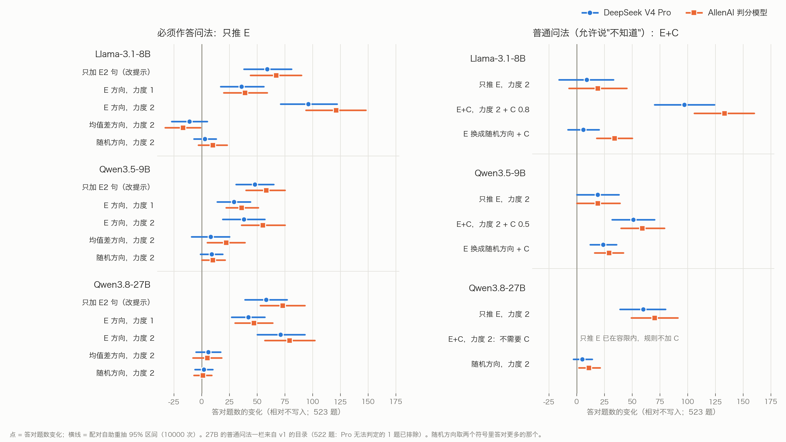

# P2. 自由回答：529 道测试题统一重验（Llama-3.1-8B、Qwen3.5-9B、Qwen3.8-27B）——E、C、E+C 与同作答数对照

撰写：Claude（赵磊审）。北京时间 2026-11-14 19:15。对应博士 11-10《下一步实验安排》（同目录上一级的 [`博士建议_下一步实验安排_20261110.md`](../博士建议_下一步实验安排_20261110.md)）第三部分："先做一张完整对照表、一张图，附上模型版本、题目、配置和原始输出位置。"真假判断的对应材料在 [P1](../P1_新模型真假判断_原模型_均值差_DAS对照与2x2/README.md)。

## 一句话结论

**在从没用过的 529 道测试题上，按事先写下的规则，三个模型都满足下面三点，两家裁判一致、区间不跨 0。积极**
- E（真实方向）在必须作答问法上显著多答对；
- C（承诺方向）只改作答量；
- E+C 在普通问法上把作答量对齐的同时多答对。

**要如实写的：**
- 同样作答数下，E+C 没有达到"两家裁判都显著胜过'只推 E + 按模型自己的把握挑题'"。Llama、27B 在力度 2 时偏向 E+C，9B 打平。所以不写"组合胜过任何单一方向"。**消极**（针对这句强话）
- 27B 只推 E 在普通问法上就成立（力度 2：+60，作答量不变）。"只推 E 不够"只对 Llama、9B 成立。

## 1. 完整对照表

**名词**
- **E**（truth direction · 真实方向 · 推它，模型更倾向给事实正确的答案）：用 DAS（distributed alignment search · 分布式对齐搜索 · 用梯度训练出"换掉它、答案就跟着换"的方向）在训练集上学到。
- **C**（commitment direction · 承诺方向 · 推它，模型更敢答或更谨慎）。
- **必须作答问法**：要求模型必须给出答案；**普通问法**：允许说"不知道"。
- **只加 E2 句**：不写入，只在问法里加一句"题目可能建立在流行误解或错误前提上，给事实正确的答案"。
- **均值差方向**：两类回答激活的平均之差，最简单的对照方向。**随机方向**：同样大小的随机方向，正负两个都跑。
- **同作答数对照**：E+C 作答了 N 道题；对照系统按模型自己对答案的把握（自己答案的平均对数概率）挑出同样 N 道题作答，比谁答对的多。

**读法**
- 每格都是相对不写入时的变化：先写 DeepSeek V4 Pro，括号里是 AllenAI（TruthfulQA 官方判分模型）。
- 方括号是配对自助重抽（paired bootstrap · 成对重抽 · 同一批题整体重抽 10000 次）的 95% 区间。
- 题数 523（6 道金标只有"无可奉告"的题排除）；27B 的 v1 E+C 目录是 522（Pro 无法判定的 1 道题排除，见第 4 节）。
- 全表（含两个随机方向、C 换成随机方向、每个目录）在 [`表/ff_table_529.md`](表/ff_table_529.md)。那张表和本页的数字，都由 [`表/ff_p2_summary.json`](表/ff_p2_summary.json) 生成。JSON 是用出表程序本身从判分结果重算的，没有手抄的数。

**① E：必须作答问法，答对题数变化**

| 模型（E 层） | 只加 E2 句 | E 方向，力度 1 | E 方向，力度 2 | 均值差方向，力度 2 | 随机方向，力度 2（两个符号，Pro） | 平均词数：不写入 → 力度 2 |
|---|---|---|---|---|---|---|
| Llama（11） | +59 [+38, +81]（+67） | +36 [+17, +56]（+39） | **+96 [+71, +122]（+121）** | −11（−17） | −17 / +3 | 3.1 → 4.2 |
| 9B（15） | +48 [+31, +65]（+58） | +29 [+14, +44]（+36） | +38 [+19, +57]（+55） | +8（+22） | −15 / +9 | 3.1 → 2.7 |
| 27B（28） | +58 [+39, +77]（+73） | +42 [+27, +57]（+47） | **+71 [+50, +93]（+79）** | +6（+5） | +2 / +1 | 2.9 → 2.1 |

- 三个模型、两种力度，学到的方向都显著多答对，随机方向和均值差方向都不行。（积极）
- 力度 2 超过只改提示：Llama、27B 能，9B 不能（+38 对 +48）。（9B：中性偏消极）
- 9B 的均值差方向在 AllenAI 下也有 +22，但它让回答从 3.1 词变到 4.4 词，而 AllenAI 偏爱长回答；Pro 下是 +8，区间含 0。

**② C：普通问法，力度 0.25，作答题数变化（冻结判据 v4，B 栏看区间）**

| 模型 · C 层 | 往谨慎 | 往敢答 | 判据：Pro / AllenAI |
|---|---|---|---|
| Llama · 19 | −14 [−23, −5]（−16） | +9 [+4, +15]（+8） | **不满足** / 单向满足 |
| Llama · 31 | −16 [−25, −8]（−17） | +12 [+5, +19]（+15） | 单向满足 / 单向满足 |
| 9B · 12 / 16 / 17 | −29 / −33 / −29（−30 / −33 / −32） | +23 / +23 / +21 | 双向满足 / 双向满足 |
| 27B · 33 / 35 / 37 | −125 / −115 / −123（−126 / −116 / −124） | +88 / +87 / +88 | 双向满足 / 双向满足 |

- 判据：作答量变化超过容限（题数的 3%，16 题），胜过随机方向，两次都作答的题正确率基本不变。
- 9B、27B 全部满足；Llama 第 31 层单向满足；Llama 第 19 层在 Pro 下作答只少 14 题，没过容限。（积极为主，一处消极）

**③ E+C：普通问法，C 的力度按"说不知道"的题数事先选，不看对错（规则 R6；27B 和 Llama 第 19 层的一格用规则 v1.1）**

| 模型 · C 层 | E 力度 + C | 只推 E：答对 / 作答 | 只推 C：答对 / 作答 | **E+C：答对 / 作答** | E 换成随机方向 + C（两个符号，Pro） | 平均词数：不写入 → E+C |
|---|---|---|---|---|---|---|
| Llama · 19 | 1 + 0.5 往敢答 | −1 / −59 | +13 / +21 | +22 [+3, +42]（+20 [+0, +40]） / −10 | +5 / +1 | 3.4 → 4.1 |
| Llama · 19（v1.1） | 2 + 0.8 往敢答 | +9 / −153 | +20 / +37 | **+97 [+70, +124]（+133） / −1** | +0 / +6 | 3.4 → 6.1 |
| Llama · 31 | 1 + 0.5 往敢答 | −1 / −60 | +9 / +26 | +32 [+12, +52]（+43） / +2 | +2 / +3 | 3.4 → 4.6 |
| Llama · 31 | 2 + 0.5 往敢答 | +8 / −155 | +9 / +26 | **+99 [+73, +126]（+135） / −5** | −1 / +3 | 3.4 → 7.4 |
| 9B · 16 | 1 + 0.25 往敢答 | +20 / −24 | +11 / +23 | +33 [+18, +48]（+43） / +5 | +7 / +18 | 3.2 → 3.2 |
| 9B · 16 | 2 + 0.5 往敢答 | +19 / −60 | +25 / +36 | **+51 [+32, +70]（+59） / +7** | +4 / +24 | 3.2 → 3.1 |
| 27B · 33（v1.1） | 1 + 0.03 往敢答 | +19 / −21 | +12 / +13 | +23 [+10, +37]（+31） / −9 | +15 / +7 | 2.5 → 2.4 |
| 27B（v1.1） | 2，不加 C | **+60 [+39, +80]（+70） / +4** | — | — | 只推随机方向：+4 / +5 | 2.5 → 2.3 |

- **人话：**
  - Llama、9B 只推 E 时，大量题改说"不知道"，答对数几乎不涨。加上 C，作答量回到原来，答对大涨。
  - 把 E 换成随机方向，增益基本消失：起作用的是学到的 E 方向。（积极）
- **27B 不一样：**它的 C 很强，只要 0.03；只推 E 本身就几乎不改作答量。力度 2 时只推 E 已在容限内，规则不加 C，只推 E 就多答对 60 题。（积极；也是"只推 E 不够"的反例）
- **回答长度：**Llama 的 E+C 回答变长（3.4 → 6–7 词）。按赵磊定的规矩，Pro 下变长后答对就是真收益，以 Pro 总数为准；AllenAI 偏爱长回答，它的数更高。

**④ 同作答数对照（E+C 减对照，答对题数）**

| 模型 · C 层 | E 力度 + C | N | 对"只推 C + 按把握挑题"（弱形式） | 对"必须作答问法只推 E + 按把握挑题"（强形式） |
|---|---|---|---|---|
| Llama · 19 | 1 + 0.5 / 2 + 1 | 460 / 492 | +19 [+1, +37] / +92 [+66, +118] | −7 [−25, +11] / +14 [−3, +31]（AllenAI +24 [+5, +43]） |
| Llama · 31 | 1 + 0.5 / 2 + 0.5 | 481 / 473 | +29 [+10, +48] / +97 [+71, +123] | −3 [−21, +15] / +8 [−11, +27] |
| 9B · 16 | 1 + 0.25 / 2 + 0.5 | 476 / 478 | +25 [+10, +41] / +36 [+16, +56] | +0 [−15, +15] / +2 [−11, +15] |
| 27B · 33（v1） | 1 + 0.25 / 2 + 0.25 | 454 / 454 | 比不了（只推 C 作答的题比 N 少） | +5 [−11, +21] / **+17 [+1, +34]**（AllenAI +15 [−3, +33]） |

- **弱形式成立：**E+C 胜过"只推 C 再挑题"，两家都显著。（积极）
- **强形式没成立：**事先写下的读法要两家裁判的区间都在 0 以上，三个模型都没达到。力度 2 时 Llama、27B 偏向 E+C，9B 打平。（消极，针对"组合胜过任何单一方向"）
- **27B 用的是 v1 的 E+C：**同作答数对照要求每一档都判过，v1.1 只判了选中的那一档。

## 2. 图

- **左图：**必须作答问法，只推 E。看"E 方向"的两行有没有整段在 0 右边，并和"只加 E2 句""均值差""随机方向"比。
- **右图：**普通问法、力度 2。看"E+C"一行，并和"只推 E""E 换成随机方向 + C"比。
- 蓝圆点是 Pro，橙方块是 AllenAI；横线是 95% 区间。
- 深色背景版：`图/ff_529_dark.png`。画图程序 [`ff_p2_figure.py`](../../../claude_gpt_review/from_claude/code/scripts/review_checks/ff_p2_figure.py) 只读 JSON。

## 3. 按博士的要求附上：模型版本、题目、配置、原始输出位置

**模型**

| 模型 | 来源 | 运行环境 | 程序身份（每个结果文件都核对它） |
|---|---|---|---|
| Llama-3.1-8B-Instruct | ModelScope `LLM-Research/Meta-Llama-3.1-8B-Instruct` | 老环境（transformers 4.57.1），代码副本 `code_e45_20261112` | `ef17e8300ee3` |
| Qwen3.5-9B | ModelScope `Qwen/Qwen3.5-9B` | 新环境（transformers 5.19.0），代码副本 `code_ff_explore_20261113b`；关闭思考模式 | `7c08f9fa7fb4` |
| Qwen3.8-27B | ModelScope `Qwen/Qwen3.8-27B` | 同上，一个模型拆在两张卡上 | `95688bb47ec7` |

- **生成：**贪心解码，最多 48 个 token，每批 8 题，种子 42。
- **裁判：**
  - AllenAI 的 TruthfulQA 真实性、信息量两个判分模型（Llama-2-7B）；
  - DeepSeek `deepseek-v4-pro`，温度 0，不开思考。
  - 两家分别判，两家都成立才算。弃答单列，空回答算弃答。

**题目：**TruthfulQA 自由回答。
- 训练集：只用来学 E、C 方向；
- 调参集 192 题：探索和选层、选力度都在这里；
- 测试集 529 题：只用来报告。E44 这一轮的程序设计上就不读测试集，验证时用只放开这一处检查的外包程序。
- 测试集里 6 道金标只有"无可奉告"的题，两家裁判都不判，表里排除，所以是 523 题。

**配置：**全部按事先写下的规则（[`45`](../../../claude_gpt_review/from_claude/45_自由回答_写下来的规则v1_529题统一重验_27B按规则跑.md)），529 题上不再选任何东西。唯一的例外是 E+C 里 C 的力度：它按"说不知道"的题数选，不看对错。

| | Llama | 9B | 27B |
|---|---|---|---|
| E 的句子、层（R1、R3） | E2，第 11 层 | E2，第 15 层 | E2，第 28 层（9 个候选层里按规则选） |
| E 的力度（R4） | 1、2 | 1、2 | 1、2 |
| C 的层（R5），力度 0.25 | 19、31 | 12、16、17 | 33、35、37（10 个候选层里按规则选） |
| E+C 的 C 层（R6） | 19（31 作为第二层也报） | 16 | 33 |
| E+C 的 C 力度，v1 | 0.5 / 1（第 19 层）；0.5 / 0.5（第 31 层） | 0.25 / 0.5 | 0.25 / 0.25（作答多出约 90 题） |
| E+C 的 C 力度，v1.1 | 力度 2 改为 0.8（v1 超出容限的那一格） | 同 v1（已在容限内） | 力度 1：0.03 往敢答；力度 2：不加 C |

**原始输出位置**（服务器 Pro 5000，容器内路径 `/workspace/Truth_Decoupling/`）
- 每个判分目录的路径、判分输入和两家判决文件的 sha256，都在 [`表/ff_p2_summary.json`](表/ff_p2_summary.json) 的 `provenance` 里。例如：
  - Llama 的 E：`results_e44_factorial_das/llama3.1-8b_side_E2/judge_test_testD_E_L11/`；
  - E+C：`results_e44_factorial_das/llama3.1-8b_side_E2/eval_extra/judge_test_tll19_test/`；
  - 9B、27B 在 `results_newmodels_ff_20261112/e44/<模型>/` 下的同名目录。
- 逐题回答：每个目录的 `judge_input.json`；生成文件在 `<运行目录>/gen/*_test.json`、`<运行目录>/eval_extra/gen/*_test.json`。
- 逐格判决：每个目录的 `judge2/single_pro.jsonl`、`judge2/single_allenai.jsonl`。
- 调度日志：`results_newmodels_ff_20261112/logs/` 下的 `test_b`、`explore_n`、`explore_o`、`explore_p`、`explore_q`、`explore_r`、`test_sel`、`test_sel27`。
- 代码：[`claude_gpt_review/from_claude/code/`](../../../claude_gpt_review/from_claude/code/)。本页的汇总、出表、画图程序是 `scripts/review_checks/ff_p2_summary.py`、`ff_p2_tables.py`、`ff_p2_figure.py`。

## 4. 必须交代的

- **调参题上看过分数：**
  - 首轮按事先的设置跑，9B 不成立。之后在调参的 192 题上看着分数改了设置（E 的句子、问法、C 的力度），这正是博士说的"看完分数改设置"。
  - 所以把规则写下来，在出结果之前推到 GitHub，再用从没用过的 529 题统一重验。
- **规则改过一版（v1.1）：**
  - 起因：27B 的 C 太强，最小档 0.25 也让作答多出约 40 题。赵磊："继续调小C啊，谁说0.25就是最小档，只是我们约定的……我们现在是在探索方法，不是在做法律约定。"
  - v1.1 加了更小的档，C 的方向也按作答量定，在运行之前写下（`45` 第 3.4 节）。v1、v1.1 两版都报。
  - **一处偏离：**v1.1 只要求给超出容限的格子加密。Llama 第 19 层力度 1 原来就在容限内，调度也按加密网格重跑了这一格（+31）。按规则这一格仍取 v1 的 +22，+31 只作参照。
- **排除的题：**
  - 6 道金标只有"无可奉告"的题，两家裁判都不判。
  - 27B 的 v1 E+C 目录里，Pro 对 1 道题回答"无法判定"（tqa:310，模型答 "None"，5 个格子）。按协议不能由别人补判，所以这道题从那个目录的表里排除，两家都排除（`45` 第 3.5 节）。这是所有 Pro 判分里唯一的一处。
- **测试集不是完全没碰过：**11-04 的 v1 方案在老模型（Llama 等）上跑过这 529 题，结果是消极的。这一轮的方法、规则和 Qwen 模型没碰过它。
- **两处消极：**
  - Llama 第 19 层的 C 在 Pro 下没过容限；
  - 9B 的 E 力度 2 不如只改提示。
- **"组合胜过任何单一方向"没成立：**同作答数的强形式三个模型都没到两家都显著，见第 1 节第 ④ 部分。论文主张怎么写，请博士判断（[请博士判断](../请博士判断_只推E的定位与27B第32层均值差.md)）。
- **长度：**Llama 的 E 和 E+C 让回答变长，AllenAI 偏爱长回答，所以涉及长度时以 Pro 为准。9B、27B 的回答不变长或变短。

## 5. 下一步

- 写文章：方法、结果、和已有工作的不同（文献对照停在 11-06，要按这里的结果补）、什么情况下有效。
- 可选，请博士定：
  - 自由回答 E+C 的"均值差"对照：把 E 换成均值差方向，再加 C；
  - 27B 真假判断偏向判"真"的校准 J。
